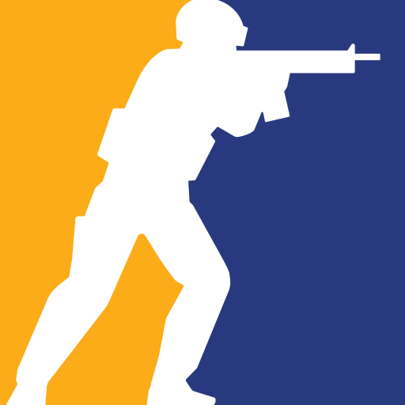

<div align="center">



# CS2 Discord RPC

**Discord Rich Presence for Counter-Strike 2.**

It shows your map, mode, score, team, K/D/A and Steam party size on your
Discord profile. It reads everything from CS2's official **Game State
Integration**, so it never touches the game process.

</div>

---

## ✨ Features

- **Map and mode** with the map icon and background, pulled from an
  auto-updating map art index. Workshop maps are supported too.
- **Live score** shown from your team's side, plus the current round, warmup
  and the final result (Victory, Defeat or Draw).
- **Team and stats**: Counter-Terrorist or Terrorist agent icon, with
  K/D/A and MVPs in the tooltip. Your own stats stay visible while you
  spectate after dying.
- **Deathmatch** shows kills and deaths instead of the score.
- **Party size** (Solo, Duo, Trio, Squad, 5-stack), read from the Steam Rich
  Presence that CS2 publishes. This is read-only.
- **Elapsed timer** that only resets when you change map or mode, not every round.
- **Zero setup for GSI**: the program finds your CS2 install in any Steam library
  and writes the GSI config for you.
- **Launches with the game**: it wraps CS2's launch command and closes when
  the game closes.

## 🧱 Tech

| Layer | Technology |
|-------|-----------|
| Language | Go 1.27 (Windows) |
| Game data | CS2 Game State Integration (local HTTP, token-authenticated) |
| Discord | Native IPC over the `discord-ipc` named pipe (no SDK) |
| Steam | `steam_api64.dll` shipped with CS2 (flat API) |
| Logging | zap |

## 🚀 Getting started

You need **Windows**, **Go 1.27+**, **Steam** with CS2 and the **Discord desktop app**.

```bash
# 1. Build (GUI subsystem, so no console window opens)
go build -ldflags "-H=windowsgui" -o cs2-discord-rpc.exe .

# 2. Run it once without arguments: it creates config.json next to the .exe
./cs2-discord-rpc.exe
```

3. Create an application named **Counter-Strike 2** at
   https://discord.com/developers/applications and paste its **Application ID**
   into `discord_client_id` in `config.json`.
4. Under **Rich Presence → Art Assets**, upload the images in `assets/` with
   their file names: `cs2_logo`, `agent_ct` and `agent_t`.
5. Run the `.exe` again. It installs the GSI config and tells you what to put in
   Steam: **Counter-Strike 2 → Properties → Launch Options**:

   ```
   "C:\path\to\cs2-discord-rpc.exe" %command%
   ```

Start CS2 from Steam as usual and your presence will appear on Discord.

## ⚙️ Configuration

`config.json` lives next to the executable:

| Key | Description |
|-----|-------------|
| `discord_client_id` | Your Discord application ID (required). |
| `port` | Local GSI port. Default `3000`. |
| `token` | GSI auth token. Generated automatically. |
| `cs2_cfg_dir` | CS2 `game\csgo\cfg` folder. Leave empty to detect it automatically. |
| `logo_image`, `ct_image`, `t_image` | Override the default art asset keys or URLs. |
| `map_images` | Per-map background overrides, e.g. `{"de_mirage": "https://..."}`. |

Logs are written to `cs2-discord-rpc.log` next to the executable.

## 📂 Structure

```
CS2_DISCORD_RPC/
├── main.go             # Setup, game wrapper and update loop
├── assets/             # Art assets to upload to your Discord app
└── internal/
    ├── config/         # config.json loading and defaults
    ├── discord/        # Discord IPC client
    ├── gsi/            # GSI server, state types and cfg installer
    ├── presence/       # Game state → Discord activity
    └── steam/          # Steam party size via steam_api64.dll
```

## ⚠️ Disclaimer

This is an unofficial project and is not affiliated with Valve or Discord. It
only uses Game State Integration and read-only Steam Rich Presence, which are
both allowed by Valve.
